# Project 08 — Identity & Access Management (IAM) Investigation

**Author:** Muhammed Trawalley  
**Platform:** Ubuntu 24.04.3 LTS (ARM64)  
**Environment:** Authorized personal virtual machine lab  
**Project Type:** Linux Security Investigation  
**Focus Areas:** Identity Management, Authentication, Authorization, Privileged Access, Password Policies, File Permissions, and Service Accounts  
**Status:** Investigation Completed — Evidence Capture and Publication Pending

---

## 1. Executive Summary

This project investigates the Identity and Access Management (IAM) configuration of an Ubuntu Linux virtual machine. The objective was to determine whether user accounts, group memberships, administrative privileges, authentication controls, password policies, resource permissions, and service identities followed reasonable security practices.

The investigation used Linux command-line utilities to inspect account databases, privilege assignments, authentication logs, password-aging settings, file permissions, access control lists (ACLs), and system services.

### Key Results

- **One primary configuration weakness identified:** The privileged `parallels` account has no password expiration date and a configured maximum password age of 99,999 days.
- **Five local graphical authentication failures identified:** Journal entries recorded failed `gdm-password` authentication attempts for `parallels`. Their cause was not established.
- **No unexpected UID 0 accounts identified:** `root` was the only account with UID 0.
- **No unexpected sudo-group members identified:** `parallels` was the only member of the `sudo` group.
- **Service identities reviewed:** The selected dedicated service accounts had non-interactive login shells and no sudo access in the checks performed.
- **File permissions reviewed:** No unexpected named ACL entries or suspicious privileged executables were identified in the inspected locations.
- **Defensive controls observed:** AppArmor was enforcing profiles, and automatic updates were enabled and running.

**Overall conclusion:** No clear evidence of compromise was identified within the scope of this investigation. This does not prove the system is free of compromise; the assessment is limited to the commands, logs, and locations examined.

---

## 2. Investigation Objectives

The investigation was designed to answer the following questions:

1. Which user accounts exist on the system?
2. Which accounts can log in interactively?
3. Which users have administrative privileges?
4. Are privileged group memberships appropriate?
5. Are authentication failures present in the available logs?
6. Are password-aging and password-quality controls configured?
7. Are sensitive files protected by appropriate permissions?
8. Are there unexpected ACL entries or privileged executables?
9. Do service accounts have unnecessary login or administrative access?
10. Which findings require remediation or additional investigation?

## 3. Lab Environment and Project Structure

The investigation was performed on a personal Ubuntu virtual machine. Commands were run for defensive analysis and evidence collection, not to alter accounts or weaken security controls.

--

# 4. Investigation Methodology

## Step 1 — Establish the Identity Baseline

### Commands executed

```bash
whoami
id
getent passwd parallels
groups
sudo -l
who
sudo passwd -S parallels
```

### Command explanations and results

**1. `whoami`**

Purpose: Displays the username of the current effective user.

Observed output:

```text
parallels
```

Interpretation: The investigation was performed from the `parallels` account.

**2. `id`**

Purpose: Displays the user's UID, primary GID, and supplementary group memberships.

Observed details:

- UID: `1000`
- Primary group: `parallels`
- Supplementary groups included `adm`, `cdrom`, `sudo`, `dip`, `plugdev`, `users`, and `lpadmin`.

Interpretation: The account belongs to several system groups, including `sudo`. Membership in `sudo` is particularly important because it grants administrative capability under the configured sudo policy.

**3. `getent passwd parallels`**

Purpose: Retrieves the account's record from the system's configured account databases.

Observed output:

```text
parallels:x:1000:1000:Parallels:/home/parallels:/bin/bash
```

Field explanation:

| Field | Value | Meaning |
|---|---|---|
| Username | `parallels` | Account name |
| Password field | `x` | Password information is stored in the shadow database |
| UID | `1000` | User identifier |
| GID | `1000` | Primary group identifier |
| Comment | `Parallels` | Account description |
| Home | `/home/parallels` | Home directory |
| Shell | `/bin/bash` | Interactive shell |

Interpretation: This is a normal human-style interactive account, rather than a service-only identity.

**4. `groups`**

Purpose: Lists the groups associated with the current user.

Observed groups:

```text
parallels adm cdrom sudo dip plugdev users lpadmin
```

Interpretation: The current account has administrative membership through `sudo`, as well as access associated with several desktop-system groups.

**5. `sudo -l`**

Purpose: Displays the commands the current user is permitted to execute through sudo.

Observed authorization:

```text
(ALL : ALL) ALL
```

Interpretation: The account can execute commands as any user and any group, subject to the configured sudo policy. This is broad administrative access.

**6. `who`**

Purpose: Displays logged-in sessions.

Observed sessions included the `parallels` account on `seat0` and `tty2`.

Interpretation: The account had active local graphical and terminal session entries at the time of inspection. Multiple session entries do not, by themselves, indicate an attack.

**7. `sudo passwd -S parallels`**

Purpose: Displays the account's password status and password-aging metadata.

Observed output:

```text
parallels P 2026-08-13 0 99999 7 -1
```

Interpretation of fields:

- `P`: A password is set.
- `2026-08-13`: Last recorded password change.
- `0`: Minimum days between password changes.
- `99999`: Maximum days before a password change is required.
- `7`: Warning period before expiration.
- `-1`: No account inactivity period is configured through this field.

The `99999` maximum age is effectively an extremely long password lifetime.

### Evidence

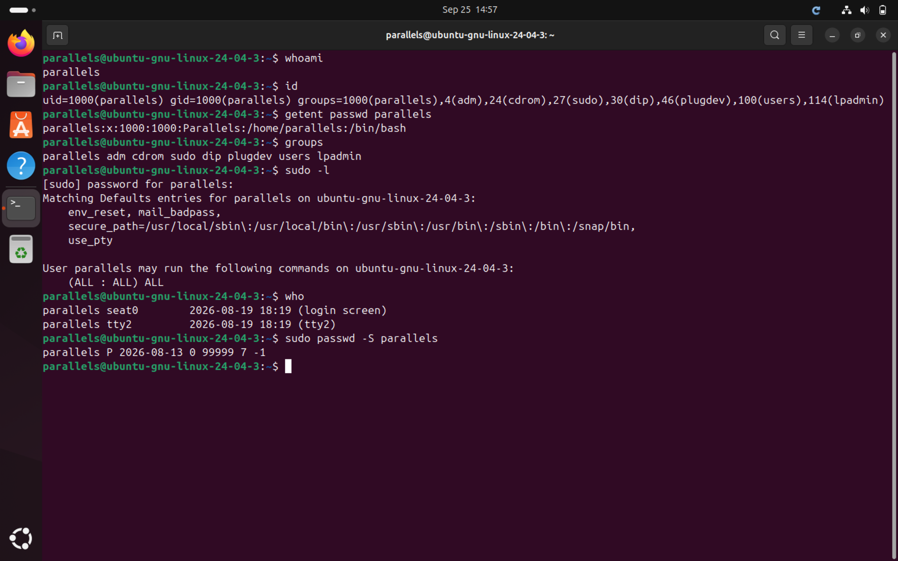

**Step 1 conclusion:** The `parallels` account is the primary interactive user and has broad administrative privileges. Its password-aging configuration requires further review.

---

## Step 2 — Inventory User Accounts

### Commands executed

```bash
getent passwd | grep -E '/bin/bash|/bin/sh'
```

```bash
getent passwd | awk -F: '$3 >= 1000 {print $1 ":" $3 ":" $6 ":" $7}'
```

```bash
getent passwd | grep -E '/usr/sbin/nologin|/bin/false'
```

```bash
getent passwd root
sudo passwd -S root
sudo chage -l parallels
```

### Command explanations and results

**1. Interactive shell inventory**

```bash
getent passwd | grep -E '/bin/bash|/bin/sh'
```

Purpose: Finds account records whose login shell is `/bin/bash` or `/bin/sh`.

Observed result: The interactive-shell inventory showed `root` and `parallels`.

Interpretation: These are the two accounts identified with conventional interactive shells. A shell entry alone does not prove that an account can successfully authenticate.

**2. UID 1000 and above inventory**

```bash
getent passwd | awk -F: '$3 >= 1000 {print $1 ":" $3 ":" $6 ":" $7}'
```

Purpose: Filters account records by UID and displays username, UID, home directory, and shell.

Observed output:

```text
nobody:65534:/nonexistent:/usr/sbin/nologin
parallels:1000:/home/parallels:/bin/bash
```

Interpretation:

- `parallels` is the primary human-style account.
- `nobody` is a restricted system identity, despite having UID 65534.
- The output does not show another normal interactive user account.

Note: UID thresholds are useful for inventory, but they do not reliably distinguish all human users from service identities on every Linux distribution.

**3. Non-interactive account inventory**

```bash
getent passwd | grep -E '/usr/sbin/nologin|/bin/false'
```

Purpose: Identifies accounts configured with common non-interactive shells.

Observed result: Numerous system and service accounts used `/usr/sbin/nologin` or `/bin/false`.

Interpretation: This is consistent with service accounts that need an identity to run processes but should not normally provide an interactive shell.

**4. Inspect the root account**

```bash
getent passwd root
```

Observed output:

```text
root:x:0:0:root:/root:/bin/bash
```

Interpretation: The root account has UID 0, the home directory `/root`, and the shell `/bin/bash`. This is normal for the system's primary administrative identity.

**5. Check root password status**

```bash
sudo passwd -S root
```

Observed status: `L`, indicating that the root password is locked.

Interpretation: Direct password authentication using the root account's locked password is disabled. This does not necessarily disable every possible way root privileges could be obtained; for example, an authorized sudo user may still execute commands as root.

**6. Inspect password-aging policy for `parallels`**

```bash
sudo chage -l parallels
```

Observed results included:

- Last password change: August 13, 2026
- Password expires: never
- Password inactive: never
- Account expires: never
- Minimum password age: 0 days
- Maximum password age: 99,999 days
- Warning period: 7 days

Interpretation: The privileged account does not have a meaningful password-expiration requirement.

### Evidence

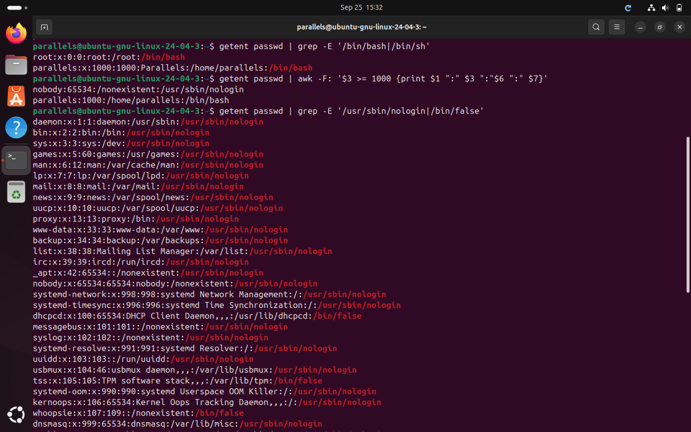
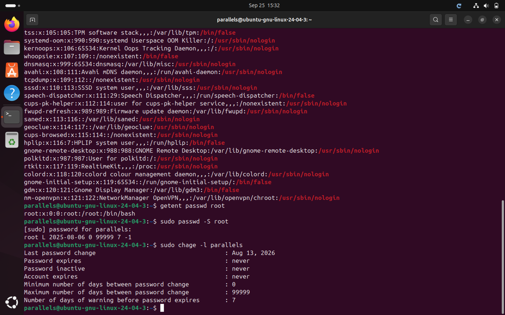

**Step 2 conclusion:** No additional unexpected human-style account was identified. The non-expiring privileged account remains a configuration weakness.

---

## Step 3 — Review Group Membership and Roles

### Commands executed

```bash
getent group
```

```bash
getent group sudo
getent group adm
getent group lxd
getent group docker
```

```bash
id -Gn parallels
```

### Command explanations and results

**1. `getent group`**

Purpose: Lists group records from the configured group databases.

Relevant observed memberships included:

```text
adm:x:4:syslog,parallels
sudo:x:27:parallels
```

Other reviewed groups included `cdrom`, `dip`, `plugdev`, `users`, and `lpadmin`.

Interpretation:

- `sudo` grants administrative capability under the sudo policy.
- `adm` can provide access to some system logs.
- `lpadmin` is associated with printer administration.
- The other memberships are consistent with common desktop-system functionality, although group membership should always be assessed against actual business or lab requirements.

**2. `getent group sudo`**

Observed output:

```text
sudo:x:27:parallels
```

Interpretation: `parallels` was the only listed member of the `sudo` group.

**3. `getent group adm`**

Observed output:

```text
adm:x:4:syslog,parallels
```

Interpretation: The group contained `syslog` and `parallels`. Because this group can provide access to system logs, membership should be deliberate.

**4. `getent group lxd`**

Observed output:

```text
lxd:x:123:
```

Interpretation: The group exists but has no listed members. LXD access can be security-sensitive because container-management capabilities may confer substantial host-level power, depending on configuration.

**5. `getent group docker`**

Observed result: No group record was returned.

Interpretation: A group named `docker` was not present in the configured group database. This does not prove that Docker software is absent; it only establishes that this group lookup returned no entry.

**6. `id -Gn parallels`**

Purpose: Lists group names associated with the specified account.

Observed memberships matched the previously collected account baseline.

### Evidence

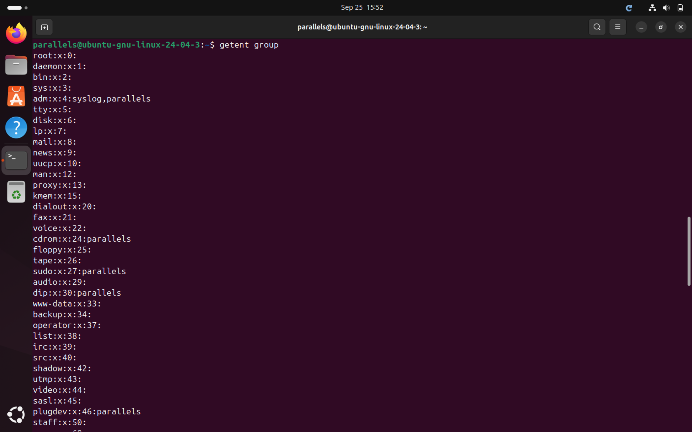
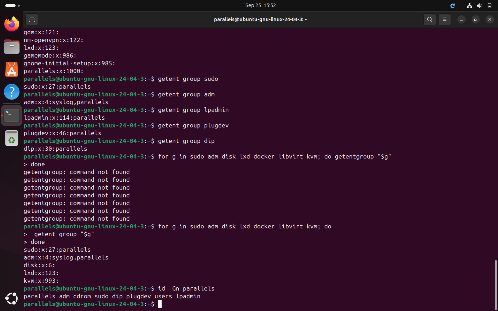

**Step 3 conclusion:** No unexpected privileged group membership was identified. The main administrative group membership belongs to the primary lab account.

---

## Step 4 — Inspect Sudo Configuration and Administrative Access

### Commands executed

```bash
sudo visudo -c
```

```bash
sudo grep -vE '^[[:space:]]*#|^[[:space:]]*$' /etc/sudoers
```

```bash
sudo find /etc/sudoers.d -maxdepth 1 -type f -ls
```

```bash
sudo journalctl _COMM=sudo --since "30 days ago" --no-pager
```

### Command explanations and results

**1. `sudo visudo -c`**

Purpose: Validates the sudoers configuration syntax without editing the policy.

Observed result:

```text
parsed OK
```

Interpretation: The sudoers configuration passed the syntax validation performed by this command.

**2. Inspect active sudoers lines**

```bash
sudo grep -vE '^[[:space:]]*#|^[[:space:]]*$' /etc/sudoers
```

Purpose: Displays lines that are not comments or blank lines.

Relevant observed rules included:

```text
root ALL=(ALL:ALL) ALL
%admin ALL=(ALL) ALL
%sudo ALL=(ALL:ALL) ALL
```

The file also included a directive to load rules from `/etc/sudoers.d`.

Interpretation:

- `root` has unrestricted administrative authorization.
- Members of the `admin` group are authorized under the displayed rule if that group exists and has members.
- Members of the `sudo` group have unrestricted command authorization under the displayed rule.
- The actual authorization decision also depends on included configuration and the applicable sudo policy.

**3. Inspect additional sudo policy files**

```bash
sudo find /etc/sudoers.d -maxdepth 1 -type f -ls
```

Purpose: Lists files immediately inside `/etc/sudoers.d`.

Observed result: The directory contained the standard `README` file; no additional custom rule file was identified by this check.

Interpretation: No unexpected extra sudo policy file was identified in the inspected directory.

**4. Review sudo-related journal records**

```bash
sudo journalctl _COMM=sudo --since "30 days ago" --no-pager
```

Purpose: Queries journal entries associated with the `sudo` process for the specified period.

Interpretation: This provides context for administrative activity during the investigation. It does not guarantee that every sudo invocation is recorded in the queried journal, and the investigator's own sudo commands may appear in the results.

### Evidence

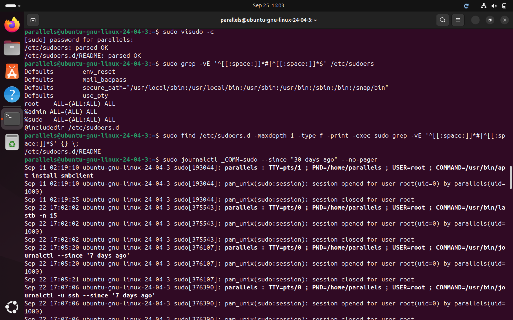
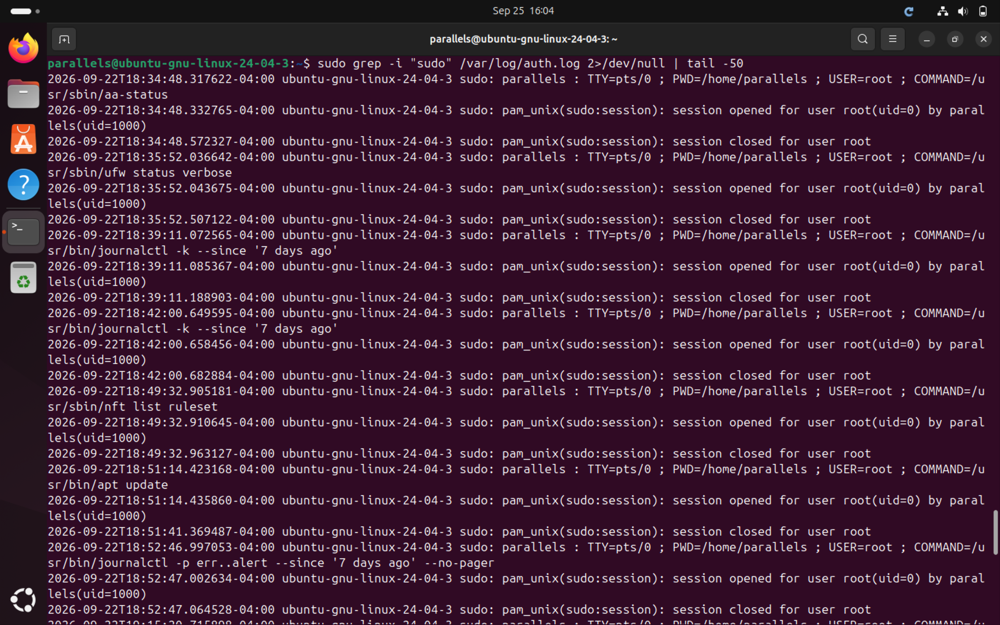

**Step 4 conclusion:** The sudo configuration passed syntax validation. No unexpected additional sudo policy file was identified. The primary account nevertheless has unrestricted administrative privileges.

---

## Step 5 — Investigate Authentication and Login Controls

### Commands executed

```bash
last -n 20
```

```bash
sudo lastb -n 20
```

```bash
systemctl status ssh --no-pager
```

```bash
sudo ss -tulpen | grep ':22 '
```

```bash
sudo sshd -T
```

```bash
sudo grep -R -E 'pam_faillock|pam_tally|pam_unix|pam_sss' /etc/pam.d/common-auth /etc/pam.d/common-account 2>/dev/null
```

```bash
sudo journalctl --since "30 days ago" --no-pager | grep -Ei 'authentication failure|failed password|invalid user|accepted password|accepted publickey|session opened|session closed' | tail -100
```

```bash
sudo journalctl --since "30 days ago" --no-pager | grep -Ei 'authentication failure|failed password|invalid user|accepted password|accepted publickey' | tail -50
```

```bash
sudo journalctl --since "2026-09-11 01:20:00" --until "2026-09-11 02:15:00" --no-pager | grep -Ei 'gdm-password|authentication|session opened|session closed'
```

```bash
systemctl status gdm --no-pager
```

```bash
sudo journalctl -u gdm --since "30 days ago" --no-pager
```

### Command explanations and results

**1. `last -n 20`**

Purpose: Displays recent login-session records from the system's login accounting data.

Observed result: The history primarily showed `parallels` sessions and system reboots.

Interpretation: The visible history did not, by itself, establish suspicious login activity. Some timestamps were inconsistent, so they were interpreted cautiously.

**2. `sudo lastb -n 20`**

Purpose: Attempts to display recorded failed login attempts from the `btmp` database.

Observed result:

```text
btmp begins Fri Sep 11 00:56:43 2026
```

No failed-login entries were displayed in the requested output.

Interpretation: No failed-login records were displayed by this query. This does not prove that no failed authentication occurred, because not every authentication mechanism necessarily writes to `btmp`.

**3. `systemctl status ssh --no-pager`**

Purpose: Checks the status of the SSH server service.

Observed result:

```text
Unit ssh.service could not be found.
```

Interpretation: The expected `ssh.service` unit was not found. This is consistent with the SSH server service not being installed or configured under that unit name.

**4. Check for a listener on port 22**

```bash
sudo ss -tulpen | grep ':22 '
```

Purpose: Lists socket information and filters for output matching the SSH port.

Observed result: No matching output.

Interpretation: No socket entry matching this filter was found. This is evidence that no matching port 22 listener was visible at the time of inspection; it is not a complete test of every possible remote-access mechanism.

**5. `sudo sshd -T`**

Purpose: Would display the effective SSH daemon configuration if `sshd` were installed and available.

Observed result:

```text
sshd: command not found
```

Interpretation: The SSH daemon executable was unavailable. No effective SSH configuration could be inspected, so no conclusions about specific `sshd` settings are made.

**6. Inspect PAM authentication and account modules**

```bash
sudo grep -R -E 'pam_faillock|pam_tally|pam_unix|pam_sss' /etc/pam.d/common-auth /etc/pam.d/common-account 2>/dev/null
```

Relevant observed entries:

```text
common-auth: pam_unix.so nullok
common-auth: pam_sss.so use_first_pass
common-account: pam_unix.so
common-account: pam_sss.so
```

Interpretation:

- `pam_unix.so` integrates traditional local Unix authentication and account checks.
- `pam_sss.so` integrates with SSSD when that identity provider is configured.
- `nullok` can permit empty passwords in the context of the relevant PAM module; its actual effect depends on the complete authentication stack and the authentication path.
- No `pam_faillock` or `pam_tally` entry was found in the two inspected common PAM files.

This is not proof that no lockout mechanism exists anywhere else in the system.

**7. Broad authentication journal search**

```bash
sudo journalctl --since "30 days ago" --no-pager | grep -Ei 'authentication failure|failed password|invalid user|accepted password|accepted publickey|session opened|session closed' | tail -100
```

Purpose: Searches recent journal messages for authentication-related terms and displays the last 100 matching lines.

Observed result: The initial search included session-open and session-close messages associated with root CRON activity.

Interpretation: Automated CRON sessions are not automatically evidence of interactive logins or suspicious behavior. Broad searches can also produce enough unrelated records to obscure specific authentication events.

**8. Targeted search for authentication failures and successes**

```bash
sudo journalctl --since "30 days ago" --no-pager | grep -Ei 'authentication failure|failed password|invalid user|accepted password|accepted publickey' | tail -50
```

Purpose: Narrows the search to common authentication-failure and SSH-style success/failure messages.

Observed result: Five failed graphical authentication events were identified for `parallels` on September 11, 2026.

The messages included:

```text
pam_unix(gdm-password:auth): authentication failure; logname=parallels uid=0 euid=0 tty=/dev/tty1 ruser= rhost= user=parallels
```

Observed times:

- 01:33:40
- 01:33:55
- 01:34:10
- 02:04:55
- 02:05:06

Interpretation:

- The PAM service name `gdm-password` associates these events with the GNOME Display Manager's graphical authentication path.
- The messages identify the local account `parallels`.
- The `rhost` field was empty in the displayed records.
- These records do not establish SSH brute force, a remote source, or successful unauthorized access.

**9. Examine the event window**

```bash
sudo journalctl --since "2026-09-11 01:20:00" --until "2026-09-11 02:15:00" --no-pager | grep -Ei 'gdm-password|authentication|session opened|session closed'
```

Purpose: Limits journal review to the period surrounding the observed authentication failures.

Observed surrounding activity included:

- `fprintd.service` starting near the failure periods.
- GNOME shell reauthentication-channel errors.
- The five GDM authentication failures.
- GNOME keyring messages stating that the login keyring password was invalid.
- Root CRON session messages.

Interpretation: The surrounding messages provide context but do not prove the exact cause of the failed logins. The presence of fingerprint-related service activity does not establish that fingerprint authentication caused the failures.

**10. Check GNOME Display Manager status**

```bash
systemctl status gdm --no-pager
```

Observed result: GDM was active and running.

Interpretation: The graphical login manager was running during the investigation.

**11. Query the GDM-specific journal unit**

```bash
sudo journalctl -u gdm --since "30 days ago" --no-pager
```

Observed result: No entries were returned for this unit-specific query.

Interpretation: This query did not return GDM journal records. It must not be interpreted as proof that GDM generated no events; the relevant messages were available through the broader journal search.

### Evidence

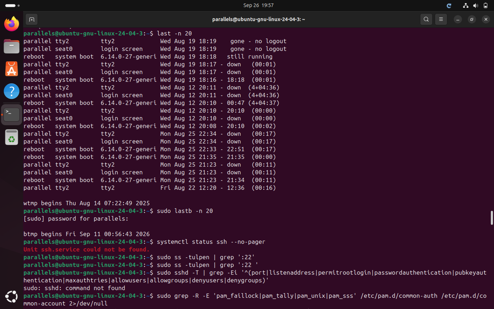
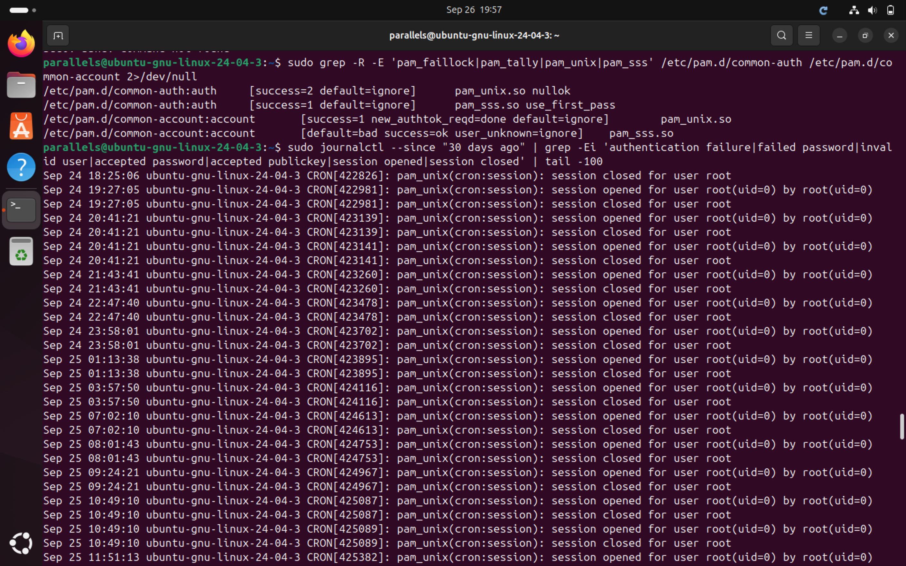
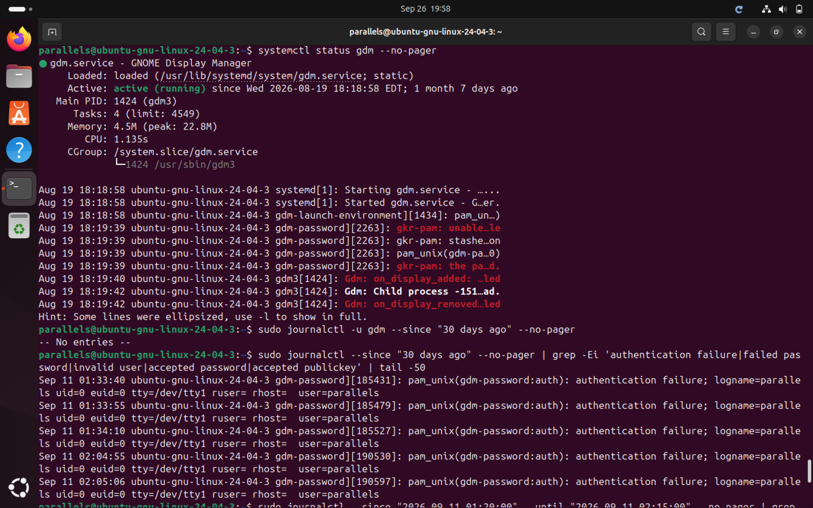
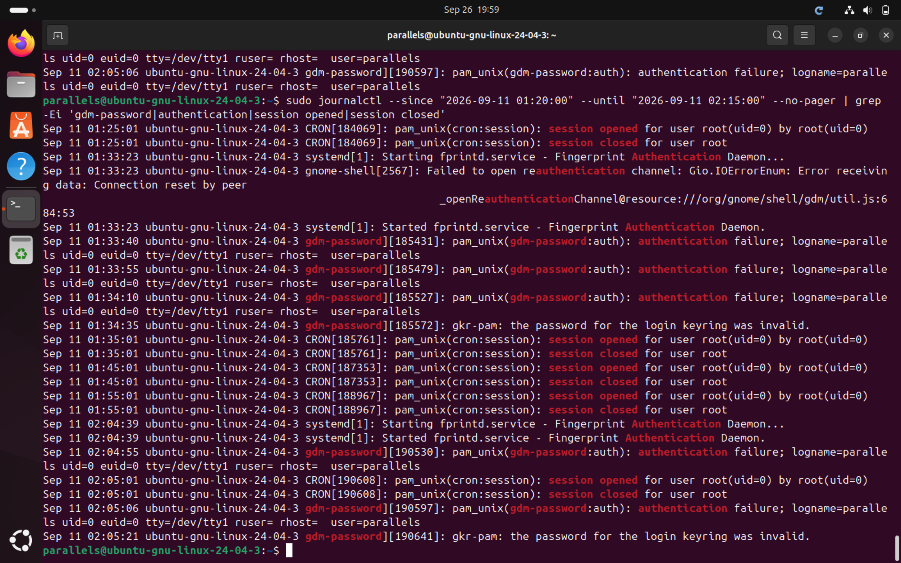

**Step 5 conclusion:** Five local graphical authentication failures require context but do not prove an attack. The SSH server executable and expected service unit were unavailable, and no port 22 listener was observed in the check performed.

---

## Step 6 — Review Password and Account Policies

### Commands executed

```bash
sudo grep -E '^(PASS_MAX_DAYS|PASS_MIN_DAYS|PASS_WARN_AGE|PASS_MIN_LEN)' /etc/login.defs
```

```bash
sudo chage -l parallels
```

```bash
sudo passwd -S root
```

```bash
sudo passwd -S parallels
```

```bash
getent passwd | awk -F: '$3 == 0 {print $1 ":" $3 ":" $7}'
```

```bash
sudo grep -R -E 'pam_pwquality|pam_passwdqc|password.*requisite|password.*required' /etc/pam.d /etc/security 2>/dev/null
```

```bash
sudo grep -vE '^[[:space:]]*#|^[[:space:]]*$' /etc/security/pwquality.conf
```

### Command explanations and results

**1. Inspect password-aging defaults**

```bash
sudo grep -E '^(PASS_MAX_DAYS|PASS_MIN_DAYS|PASS_WARN_AGE|PASS_MIN_LEN)' /etc/login.defs
```

Observed output:

```text
PASS_MAX_DAYS 99999
PASS_MIN_DAYS 0
PASS_WARN_AGE 7
```

Interpretation:

- `PASS_MAX_DAYS 99999`: A very long default maximum password age.
- `PASS_MIN_DAYS 0`: No minimum waiting period between password changes is specified by this setting.
- `PASS_WARN_AGE 7`: A seven-day warning period is specified by this setting.
- No `PASS_MIN_LEN` line was returned by this query.

These settings are defaults and do not necessarily override existing account-specific aging values.

**2. `sudo chage -l parallels`**

Purpose: Displays password-aging and account-expiration information for `parallels`.

Observed result: The account had no password expiration date and a maximum age of 99,999 days.

Interpretation: The privileged account's password is not subject to a meaningful maximum-age requirement under its current account-aging settings.

**3. `sudo passwd -S root`**

Purpose: Displays root password status.

Observed result: Root's password status was `L`, meaning locked.

Interpretation: The root account's password is locked, which is a positive control. This does not remove all possible ways of executing commands as root.

**4. `sudo passwd -S parallels`**

Purpose: Confirms password status and aging metadata for the primary user.

Observed result:

```text
parallels P 2026-08-13 0 99999 7 -1
```

Interpretation: The account has a set password and a maximum age of 99,999 days. This supports the password-lifecycle finding.

**5. Check for additional UID 0 accounts**

```bash
getent passwd | awk -F: '$3 == 0 {print $1 ":" $3 ":" $7}'
```

Observed output:

```text
root:0:/root:/bin/bash
```

Interpretation: `root` was the only account returned with UID 0. No alternate UID 0 account was identified.

**6. Inspect PAM password-quality configuration**

```bash
sudo grep -R -E 'pam_pwquality|pam_passwdqc|password.*requisite|password.*required' /etc/pam.d /etc/security 2>/dev/null
```

Relevant observed entries:

```text
/etc/pam.d/common-password:password requisite pam_pwquality.so retry=3
/etc/pam.d/common-password:password requisite pam_deny.so
/etc/pam.d/common-password:password required pam_permit.so
```

A fingerprint-related PAM file also contained a `pam_fprintd.so` password entry.

Interpretation:

- `pam_pwquality.so` is present in the inspected password stack.
- `retry=3` specifies the number of password-entry retries in that module's context.
- `requisite` means failure of that module can cause the PAM stack to fail immediately.
- `pam_deny.so` and `pam_permit.so` are PAM control modules whose effects depend on their positions and control flags in the complete stack.

The presence of `pam_pwquality` alone does not establish the effective password length or complexity requirements.

**7. Inspect explicit password-quality settings**

```bash
sudo grep -vE '^[[:space:]]*#|^[[:space:]]*$' /etc/security/pwquality.conf
```

Observed result: No output.

Interpretation: No active, nonblank configuration line was returned from this file. The module may still use defaults or settings from another configuration location.

### Evidence

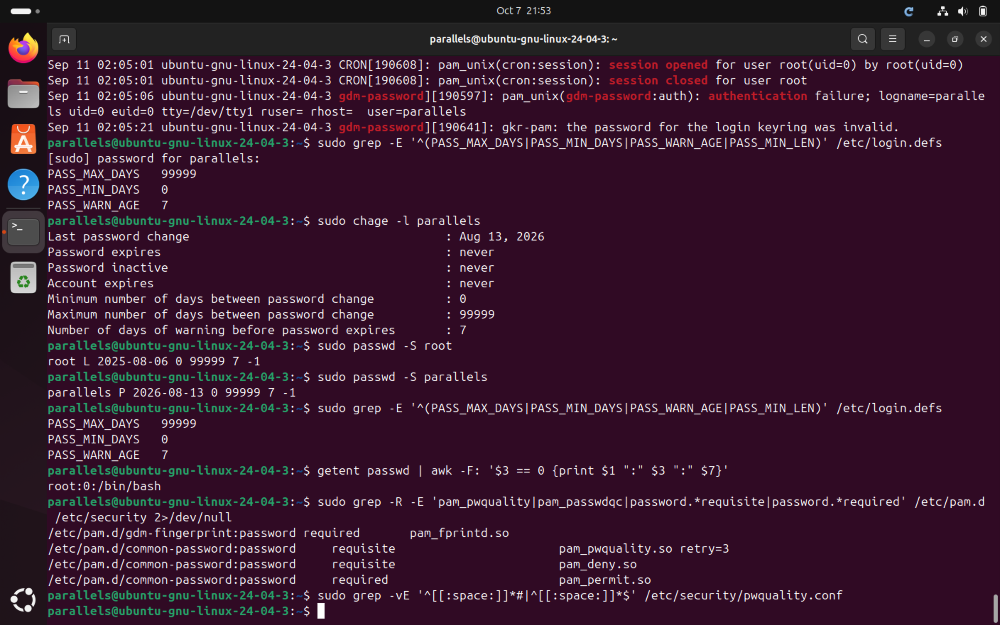

**Step 6 conclusion:** The primary finding is that the privileged account's password has no meaningful expiration requirement. The password-quality module is present, but the effective complexity policy requires further validation.

---

## Step 7 — Inspect Resource Permissions, ACLs, and Privileged Executables

### Commands executed

```bash
ls -ld /home/parallels /etc /etc/passwd /etc/shadow /var/log /root
```

```bash
getent group syslog
```

```bash
sudo find / -xdev -type f \( -perm -4000 -o -perm -2000 \) -printf '%M %u %g %p\n' 2>/dev/null | sort
```

```bash
sudo getfacl -p /etc/passwd /etc/shadow /home/parallels /root /var/log 2>/dev/null
```

```bash
sudo find /etc /usr/local/bin /usr/local/sbin -xdev -type f -user parallels -ls 2>/dev/null
```

### Command explanations and results

**1. Inspect sensitive path permissions**

```bash
ls -ld /home/parallels /etc /etc/passwd /etc/shadow /var/log /root
```

Purpose: Displays permission bits, ownership, and group ownership for important directories and files. The `-d` option displays directory metadata rather than listing directory contents.

Observed permissions:

| Path | Observed permissions | Owner/group | Assessment |
|---|---|---|---|
| `/etc` | `drwxr-xr-x` | `root:root` | Typical system-directory permissions |
| `/etc/passwd` | `-rw-r--r--` | `root:root` | Readable account database; root-writable |
| `/etc/shadow` | `-rw-r-----` | `root:shadow` | Restricted password-hash database |
| `/home/parallels` | `drwxr-x---` | `parallels:parallels` | Owner and group access; no access for others |
| `/root` | `drwx------` | `root:root` | Root-only directory access |
| `/var/log` | `drwxrwxr-x` | `root:syslog` | Group has write permission; requires appropriate membership control |

Interpretation: The inspected sensitive paths showed expected ownership patterns. The group-write permission on `/var/log` makes group membership relevant to log integrity, so the `syslog` group was checked separately.

**2. Inspect `syslog` group membership**

```bash
getent group syslog
```

Observed result:

```text
syslog:x:102:
```

Interpretation: No supplementary group members were listed in this record. This reduces concern about additional users obtaining group-based write access through supplementary membership, but does not replace a full review of the directory's effective permissions and service access.

**3. Inventory SUID and SGID executables**

```bash
sudo find / -xdev -type f \( -perm -4000 -o -perm -2000 \) -printf '%M %u %g %p\n' 2>/dev/null | sort
```

Purpose:

- `sudo find /`: Searches from the filesystem root with administrative permissions.
- `-xdev`: Avoids descending into other mounted filesystems.
- `-type f`: Restricts results to regular files.
- `-perm -4000`: Matches files with the SUID bit.
- `-perm -2000`: Matches files with the SGID bit.
- `-printf`: Displays permissions, owner, group, and path.
- `2>/dev/null`: Suppresses error messages such as permission-denied output.
- `sort`: Orders the results for easier review.

Observed examples included standard system executables such as:

- `/usr/bin/passwd`
- `/usr/bin/sudo`
- `/usr/bin/su`
- `/usr/bin/mount`
- `/usr/bin/umount`
- `/usr/bin/gpasswd`
- `/usr/bin/chsh`
- `/usr/bin/chfn`
- `/usr/bin/pkexec`
- `/usr/lib/dbus-1.0/dbus-daemon-launch-helper`
- `/usr/lib/openssh/ssh-keysign`
- `/usr/bin/crontab`

Interpretation: SUID/SGID files are security-sensitive because they can execute with additional user or group privileges. The inspected results were located in standard system paths, and no obvious suspicious executable was identified. This does not prove that every binary is safe; validating unexpected ownership, package integrity, and changes over time would provide stronger assurance.

**4. Inspect ACLs**

```bash
sudo getfacl -p /etc/passwd /etc/shadow /home/parallels /root /var/log 2>/dev/null
```

Purpose: Displays access control lists for the selected files and directories. The `-p` option preserves the full path in the output.

Observed result: The ACL entries reflected the expected owner/group/other permission model. No unexpected named-user or named-group ACL entry was identified.

Interpretation: No additional named ACL grant was found on the inspected paths. This assessment is limited to the five specified locations.

**5. Find files owned by `parallels` in sensitive system directories**

```bash
sudo find /etc /usr/local/bin /usr/local/sbin -xdev -type f -user parallels -ls 2>/dev/null
```

Purpose: Searches selected configuration and executable directories for regular files owned by `parallels`.

Observed result: No output.

Interpretation: No matching files owned by `parallels` were found in the inspected locations. This does not establish ownership conditions outside those paths.

### Evidence

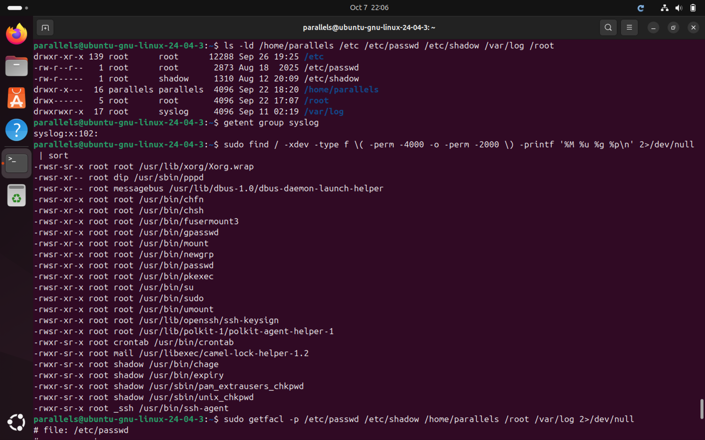
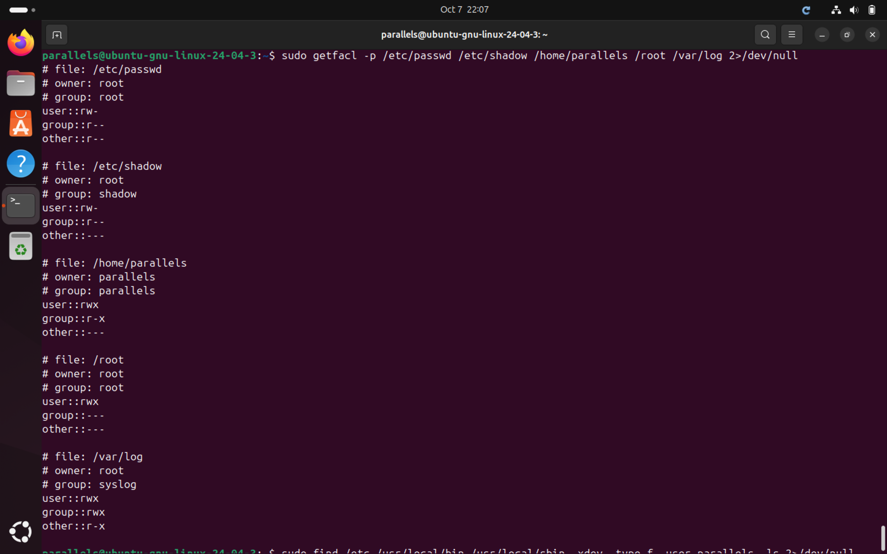
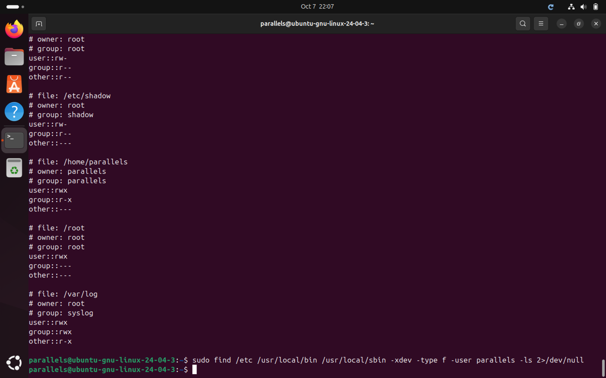

**Step 7 conclusion:** The inspected file permissions and ACLs showed no obvious anomaly. No suspicious SUID/SGID executable or unexpected `parallels`-owned file was identified in the searched locations.

---

## Step 8 — Review Service and Application Identities

### Commands executed

```bash
systemctl list-units --type=service --state=running --no-legend | awk '{print $1}' | while read s; do u=$(systemctl show "$s" -p User --value 2>/dev/null); [ -z "$u" ] && u=root; echo "$u $s"; done | sort
```

```bash
for u in colord cups-browsed gnome-remote-desktop kernoops polkitd systemd-oom systemd-resolve; do
    echo "===== $u ====="
    id "$u" 2>/dev/null
    sudo -n -l -U "$u" 2>/dev/null | head -20
done
```

```bash
for u in colord cups-browsed gnome-remote-desktop kernoops polkitd systemd-oom systemd-resolve; do
    getent passwd "$u"
done
```

```bash
getent passwd | awk -F: '$6 != "/" && $6 != "/nonexistent" {print $1 ":" $3 ":" $6 ":" $7}'
```

### Command explanations and results

**1. Inventory running service identities**

The first command enumerates running system services, queries each unit's configured `User` property, treats an empty value as `root` for display, and sorts the results.

Important limitation: An empty `User` property is generally consistent with the system service defaulting to root, but this compact inventory is not a full analysis of all unit directives, privilege changes, or process credentials.

Observed service identities included:

| Identity | Example service |
|---|---|
| `root` | `cron.service`, `cups.service`, `gdm.service`, `NetworkManager.service` |
| `colord` | `colord.service` |
| `cups-browsed` | `cups-browsed.service` |
| `gnome-remote-desktop` | `gnome-remote-desktop.service` |
| `kernoops` | `kerneloops.service` |
| `polkitd` | `polkit.service` |
| `systemd-oom` | `systemd-oomd.service` |
| `systemd-resolve` | `systemd-resolved.service` |
| `1000` | `user@1000.service` |

Interpretation: Core services running as root are common on Linux. Other services use dedicated identities. `user@1000.service` is associated with the systemd user manager for UID 1000; it is not itself evidence of a suspicious service account.

**2. Inspect service-account identity and sudo access**

The loop performs two checks for each selected account:

- `id "$u"` displays its UID, primary GID, and group memberships.
- `sudo -n -l -U "$u"` attempts a non-interactive sudo authorization listing for that user.
- `head -20` limits displayed output to the first 20 lines.

The `-n` option prevents sudo from prompting interactively. Because error output is redirected, the absence of displayed sudo rules must be interpreted together with the command's limitations.

Observed accounts included:

| Account | UID | Group information |
|---|---:|---|
| `colord` | 118 | Dedicated service group |
| `cups-browsed` | 115 | Member of `lpadmin` |
| `gnome-remote-desktop` | 988 | Dedicated service group |
| `kernoops` | 106 | Uses `nogroup` as its primary group |
| `polkitd` | 987 | Dedicated service group |
| `systemd-oom` | 990 | Dedicated service group |
| `systemd-resolve` | 991 | Dedicated service group |

The sudo checks did not display authorized sudo rules for these accounts.

Interpretation: The selected accounts use dedicated service identities and did not show sudo access in the checks performed. This is consistent with least privilege.

**3. Inspect service-account home directories and shells**

```bash
for u in colord cups-browsed gnome-remote-desktop kernoops polkitd systemd-oom systemd-resolve; do
    getent passwd "$u"
done
```

Observed records ended with `/usr/sbin/nologin`, for example:

```text
gnome-remote-desktop:x:988:988:GNOME Remote Desktop:/var/lib/gnome-remote-desktop:/usr/sbin/nologin
```

Interpretation: The inspected service accounts use non-interactive shells, which helps prevent ordinary shell logins through those identities.

**4. Inventory accounts with non-root home paths**

```bash
getent passwd | awk -F: '$6 != "/" && $6 != "/nonexistent" {print $1 ":" $3 ":" $6 ":" $7}'
```

Purpose: Lists accounts whose home-directory field is neither `/` nor `/nonexistent`.

Observed records included system accounts with paths such as `/var/lib/colord`, `/var/lib/sss`, `/var/lib/fwupd`, `/var/www`, and `/var/lib/gnome-remote-desktop`, as well as:

```text
root:0:/root:/bin/bash
parallels:1000:/home/parallels:/bin/bash
```

Interpretation: The output includes system accounts with service-specific directories. This command does not, on its own, establish that every listed directory exists or is correctly permissioned. Combined with the shell and sudo checks, it supports the conclusion that the selected service identities follow a non-interactive pattern.

### Evidence

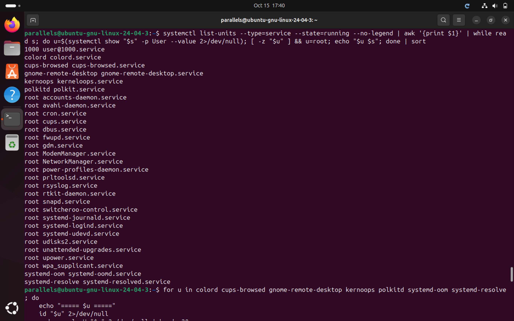
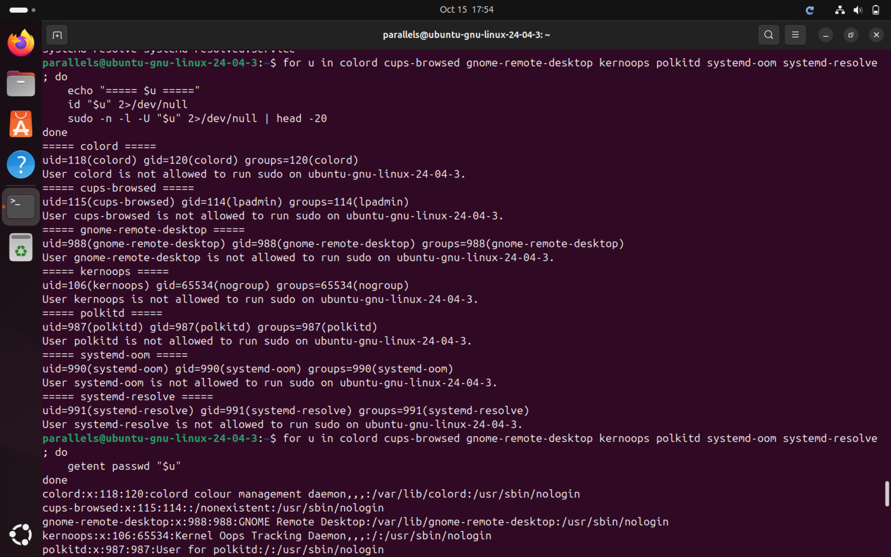
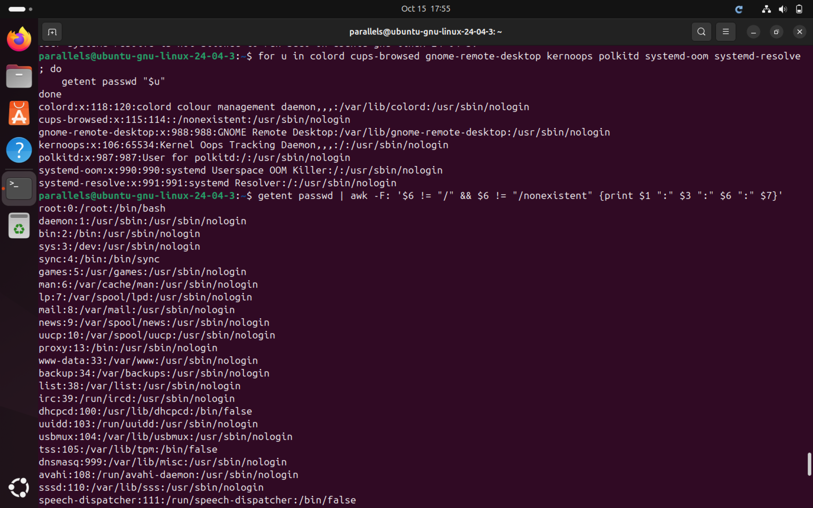

**Step 8 conclusion:** No obvious service-account privilege anomaly was identified in the accounts reviewed. Dedicated identities had non-interactive shells and no sudo rules were displayed by the checks performed.

---

## Step 9 — Consolidate Privileged Access Findings

### Commands executed

```bash
getent group sudo
```

```bash
getent group admin
```

```bash
getent passwd | awk -F: '$3 >= 1000 {print $1 ":" $3 ":" $6 ":" $7}'
```

```bash
getent passwd | awk -F: '$3 == 0 {print $1 ":" $3 ":" $6 ":" $7}'
```

```bash
getent group adm
```

```bash
getent group lxd
```

```bash
getent group docker 2>/dev/null || echo "docker group not present"
```

### Command explanations and results

**1. Confirm sudo membership**

```bash
getent group sudo
```

Observed output:

```text
sudo:x:27:parallels
```

Interpretation: `parallels` is the only listed sudo-group member.

**2. Check the legacy `admin` group**

```bash
getent group admin
```

Observed result: No output.

Interpretation: No `admin` group record was returned. The sudoers file still contains a rule referencing `%admin`, but that does not establish that the group exists or has members.

**3. Recheck accounts with UID 1000 and above**

```bash
getent passwd | awk -F: '$3 >= 1000 {print $1 ":" $3 ":" $6 ":" $7}'
```

Observed output:

```text
nobody:65534:/nonexistent:/usr/sbin/nologin
parallels:1000:/home/parallels:/bin/bash
```

Interpretation: The only normal interactive user in this filtered output was `parallels`. The `nobody` identity is restricted and non-interactive.

**4. Recheck UID 0 accounts**

```bash
getent passwd | awk -F: '$3 == 0 {print $1 ":" $3 ":" $6 ":" $7}'
```

Observed output:

```text
root:0:/root:/bin/bash
```

Interpretation: Only `root` was returned with UID 0.

**5. Recheck `adm` membership**

```bash
getent group adm
```

Observed output:

```text
adm:x:4:syslog,parallels
```

Interpretation: `parallels` has log-related group membership in addition to sudo access. This should be considered in the privilege baseline, but it is not automatically an anomaly.

**6. Recheck LXD membership**

```bash
getent group lxd
```

Observed output:

```text
lxd:x:123:
```

Interpretation: The group has no listed members.

**7. Check the Docker group**

```bash
getent group docker 2>/dev/null || echo "docker group not present"
```

Observed result: `docker group not present`.

Interpretation: The group lookup failed and the fallback message was displayed. No `docker` group was present in the configured group database at the time of inspection.

### Evidence

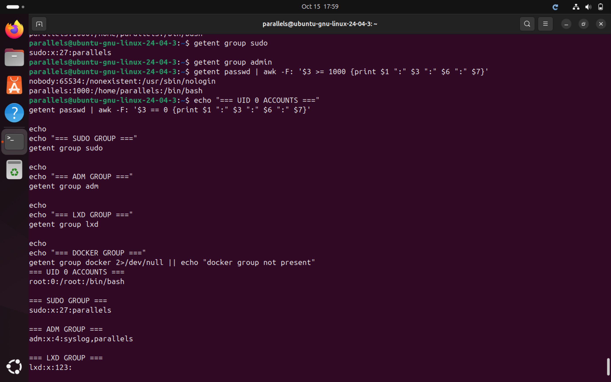
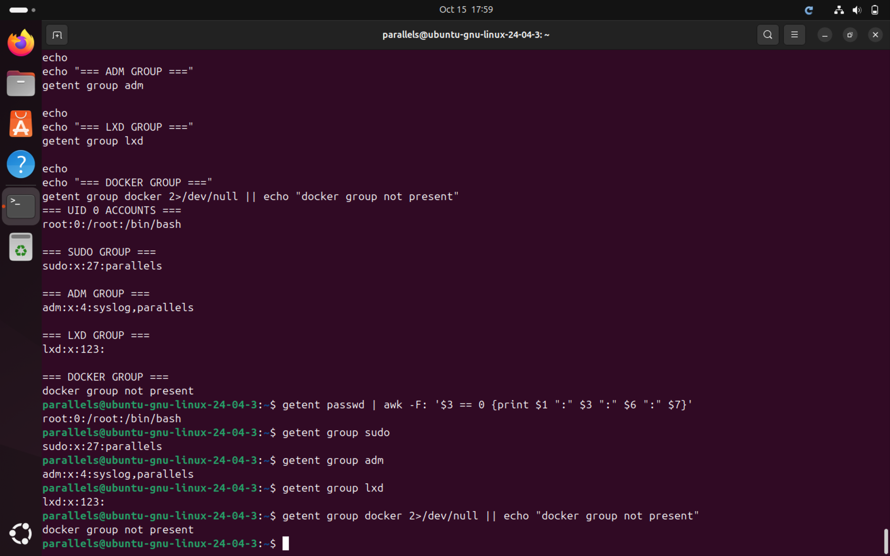

**Step 9 conclusion:** The final privilege snapshot did not identify an alternate UID 0 account or an unexpected sudo-group member. The primary user is the sole listed sudo member and should be treated as a privileged administrative identity.

---

# 5. Final Findings Register

| ID | Finding | Severity | Evidence-based assessment |
|---|---|---|---|
| IAM-01 | Privileged password has no meaningful expiration | Medium | `parallels` has sudo access, maximum password age 99,999 days, and no expiration date |
| IAM-02 | Five local GDM authentication failures | Low / Investigative | Failed `gdm-password` PAM events for `parallels`; cause undetermined |
| IAM-03 | Primary user has broad administrative access | Informational | `parallels` is the only listed sudo member; expected in this lab |
| IAM-04 | Effective password-quality requirements not confirmed | Informational / Review | `pam_pwquality` is present, but the inspected configuration file has no active settings |
| IAM-05 | Selected service accounts follow non-interactive patterns | Informational | Dedicated service identities use `/usr/sbin/nologin` or `/bin/false`; no sudo rules were displayed for the selected accounts |

Severity ratings are qualitative and reflect this personal lab's context. An enterprise assessment should use the organization's approved risk methodology.

## 6. Recommended Remediation and Follow-Up

### Priority 1 — Review privileged-account credential policy

- Decide on an appropriate password lifecycle policy for the `parallels` account.
- Require immediate credential replacement when compromise is suspected.
- Validate effective password-quality requirements.
- Consider separating routine activity from administrative work.
- Use MFA where supported by the authentication environment.

No policy changes were made during this investigation.

### Priority 2 — Monitor local authentication failures

- Investigate repeated GDM failures if they recur.
- Correlate authentication events with local user activity and surrounding system logs.
- Avoid classifying isolated local failures as a confirmed attack without corroborating evidence.

### Priority 3 — Maintain the IAM baseline

- Review sudo membership periodically.
- Check service accounts after installing or updating services.
- Monitor sensitive file permissions and privileged executables.
- Maintain AppArmor and automatic-update controls.
- Revisit account and login policy if the VM is converted into a shared or externally exposed environment.

---

## 7. Skills Demonstrated

- Linux account and group enumeration
- Authentication-log investigation
- Privileged-access review
- Password-aging and PAM configuration analysis
- File permission and ACL review
- SUID/SGID executable inventory
- Service-account security assessment
- Command-line filtering with `grep` and `awk`
- Evidence collection and technical documentation
- Risk classification and security recommendations

## 8. Final Assessment

The investigation found a generally consistent IAM configuration for a single-user Ubuntu lab. The most significant improvement opportunity is the privileged account's password-aging policy. Five local graphical authentication failures were observed, but the available evidence does not establish an attack or compromise.

The assessment also found no unexpected UID 0 account, no additional sudo-group member, and no obvious service-account privilege anomaly in the reviewed scope.

**Final status:** Investigation completed. Evidence capture, repository review, and publication remain to be finalized.

**Note:** This project demonstrates a structured, evidence-based IAM review. The findings are deliberately limited to what the collected commands and logs support; they do not constitute a guarantee that the system is uncompromised.
